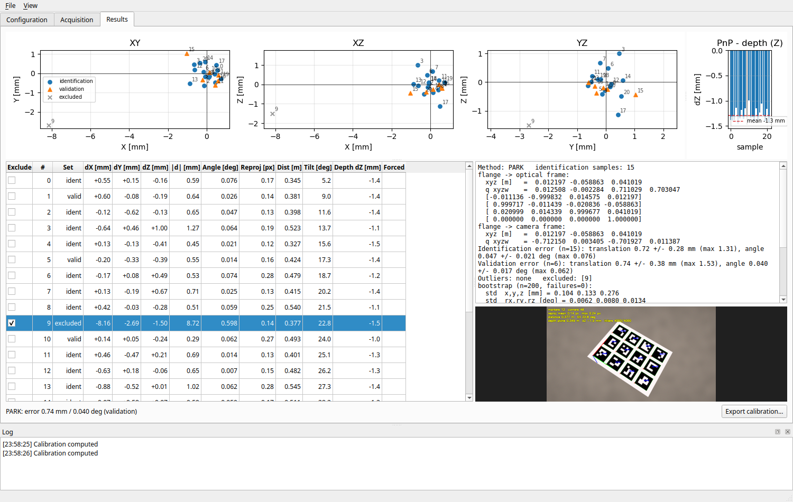

# handeye_gui

Stand-alone GUI (PySide6, no RViz) for hand-eye calibration on ROS 2, with an ArUco grid:

- **eye-in-hand**: camera on the robot flange (e.g. a RealSense D435), target fixed in the cell;
- **eye-to-hand**: camera fixed in the cell, target mounted on the flange.

- Live detection of an ArUco grid, PnP pose, reprojection error, distance and tilt.
- Optional check against the depth image: RANSAC plane fit on the target area,
  compared with the PnP pose.
- Stability indicator: the *Take sample* button is black when robot and target are
  still, red otherwise (red still works, after a confirmation).
- Motion through MoveIt (`move_group` actions): plan/execute with velocity and
  acceleration scaling, candidate poses from a joint-states file or a Fibonacci
  hemisphere, random poses around the target.
- Pose goals go through MoveIt IK (`/compute_ik`, any IK plugin) with a limit on the
  joint motion from the current configuration: far solutions (elbow flips, full wrist
  turns) are rejected and other seeds around the current configuration are tried.
- Drop-downs with the topics, TF frames, planning groups and actions found in the ROS
  graph; names that do not exist are shown in red, and Plan/Execute stay disabled
  while the MoveIt names are wrong.
- *View target* shows the configured grid with its marker ids and exports it at real
  size (PDF/SVG/PNG) for printing.
- Configuration changes not applied yet are flagged, with a warning when leaving the tab.
- Autosave after every change: if the GUI dies, the next start offers to restore the session.
- The five OpenCV solvers (Tsai, Park, Horaud, Andreff, Daniilidis).
- Identification/validation split, bootstrap (parameter covariance), outlier
  detection, per-sample chain-closure errors, pose coverage index.
- Everything is saved in one session folder that the CLI can recompute offline.



## Install

```bash
# PySide6 has no Ubuntu 24.04 package usable with ROS Jazzy: use pip
pip install --user --break-system-packages PySide6

cd ~/projects/ros2_ws
colcon build --packages-select handeye_gui
source install/setup.bash
```

Other dependencies (`rclpy`, `cv_bridge`, `tf2_ros_py`, `moveit_msgs`, numpy, scipy,
OpenCV >= 4.7 with the `aruco` module, matplotlib, PyYAML) come with ROS / rosdep.

> If OpenCV comes from the pip `opencv-python` wheel, it bundles Qt5. The GUI removes
> the Qt plugin path that wheel sets, so PySide6 (Qt6) loads its own plugins.
> `opencv-python-headless` avoids the issue entirely.

## Run

```bash
# Robot + MoveIt (move_group) + camera must be running, e.g.
ros2 launch realsense2_camera rs_launch.py align_depth.enable:=true

ros2 run handeye_gui handeye_gui                       # default config
ros2 run handeye_gui handeye_gui --config my.yaml      # start with a config file
ros2 run handeye_gui handeye_gui --session ~/calib/s1  # reopen a session
ros2 run handeye_gui handeye_gui --offline --session ~/calib/s1   # review, no ROS
ros2 launch handeye_gui handeye_gui.launch.py config:=/path/my.yaml use_sim_time:=true
```

Offline recomputation:

```bash
ros2 run handeye_gui handeye_cli ~/calib/s1 --method all --ratio 0.7 --bootstrap 200
ros2 run handeye_gui handeye_cli ~/calib/s1 --exclude 3 7 --write
```

See [docs/TUTORIAL.md](docs/TUTORIAL.md) for a step-by-step calibration and
[docs/API.md](docs/API.md) for the Python API.

## Conventions

| Item | Convention |
| --- | --- |
| Units | metres, radians inside the code; degrees in the GUI and config |
| Quaternions | ROS order `x y z w` |
| Robot pose | `T_base_flange`: flange pose in the base frame (from TF) |
| Target pose | `T_camera_target`: target pose in the image (optical) frame (from PnP) |
| Result, eye-in-hand | `X = T_flange_optical`; also flange -> `camera_frame` when it differs from the image frame |
| Result, eye-to-hand | `X = T_base_optical`; also base -> `camera_frame` |
| Target frame | OpenCV board convention: origin at the top-left corner of marker 0, X right, Y down, Z into the board |

The chain that must close for every sample is

```
eye-in-hand:  T_base_target   = T_base_flange_i · X · T_camera_target_i     (constant)
eye-to-hand:  T_flange_target = T_flange_base_i · X · T_camera_target_i     (constant)
```

Both use the same OpenCV solver; for eye-to-hand the robot poses are inverted.
The calibration type is chosen in the Configuration tab (`calibration_type`).

## Session folder

```
session/
  config.yaml     CalibConfig
  samples.yaml    samples + metadata (image frame, optical -> camera_frame)
  results.yaml    last calibration report
  images/         sample_XXX.png and sample_XXX_decorated.png
```

An unsaved session works in `/tmp/handeye_calibration_gui_temporary_save/<date>_<id>/`
and is rewritten there after every change (atomically: temporary file + rename). A
session already saved to a folder is mirrored there instead, so your folder changes
only when you save. On a clean exit the autosave is deleted; after a crash the next
start offers to restore it. `/tmp` may be emptied at reboot: save the session anyway.

## Package layout

```
handeye_gui/
  core/        calibration logic, no Qt and no ROS (tested with pytest)
    config.py  sample.py  session.py  autosave.py  solvers.py  evaluation.py
    coverage.py  geometry.py  target.py  target_print.py  poses.py  export.py
    ik_search.py  robot_model.py  ros_names.py
  ros/         rclpy integration
    ros_thread.py  camera_manager.py  tf_manager.py  motion_manager.py
    robot_description.py
  gui/         PySide6 widgets
    main_window.py  tab_config.py  tab_acquisition.py  tab_results.py
    target_dialog.py  widgets/
  cli.py       offline recomputation
```

Data flow: the GUI calls slots on `RosThread`; managers work in the ROS thread
(image processing in its own worker thread) and answer with Qt signals; the GUI
only updates views. The calibration logic lives in `core` and knows nothing about
Qt or ROS.

## Tests

```bash
cd src/calibration/handeye_gui
python3 -m pytest test
```

The tests use synthetic data with known ground truth: all five solvers in both
calibration types, the evaluation, session save/load, autosave and restore,
joint-state files, RANSAC, pose generation, the IK seed search, URDF/SRDF parsing,
the ROS name checks, the printable target (rendered and detected again) and a
rendered ArUco board for detection, PnP and the depth check.

## License

Apache License 2.0, see [LICENSE](LICENSE).
