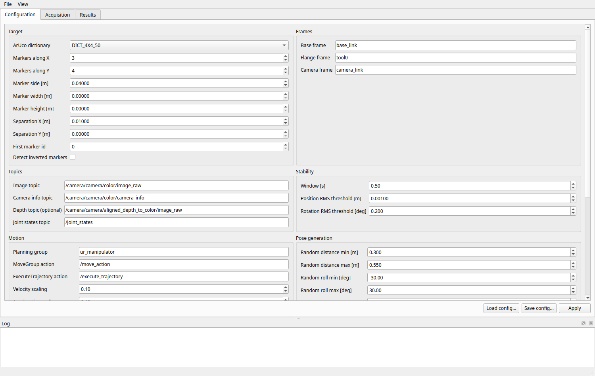
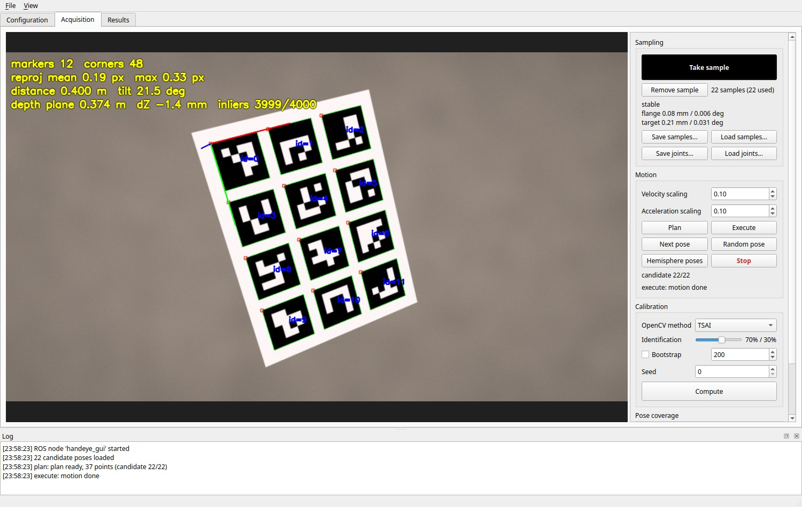
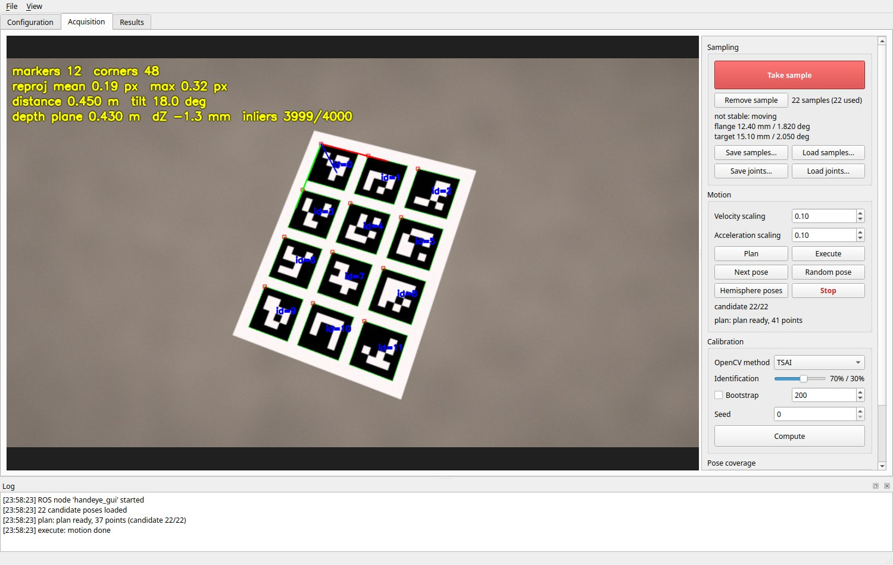
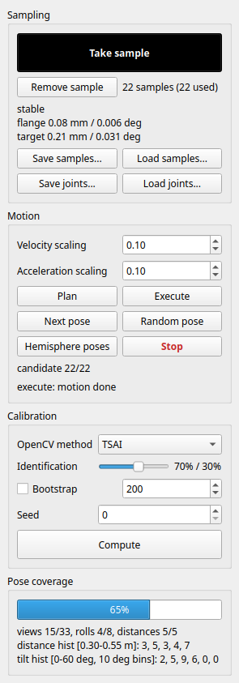
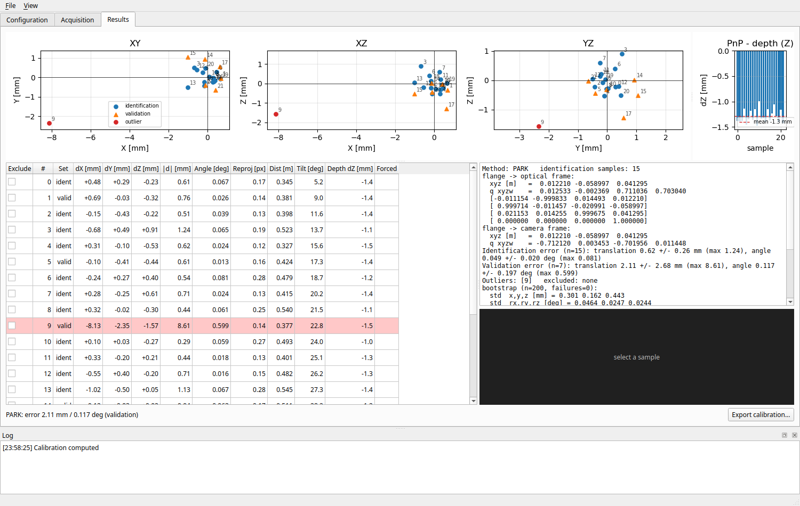
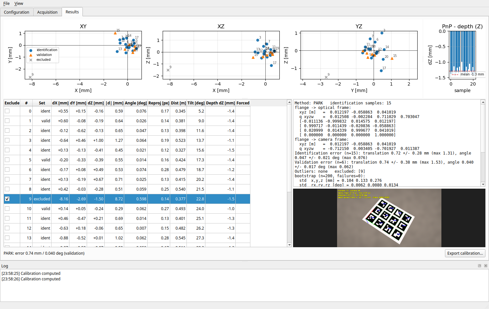

# Tutorial: eye-in-hand calibration of a RealSense D435

This walks through a full calibration: a D435 mounted on the robot flange, an
ArUco grid fixed on the table, MoveIt running for the arm.

> The screenshots in this tutorial come from the real GUI fed with a synthetic
> session: rendered images of a 3 x 4 grid with noise, processed by the same
> detection, PnP and depth code, and robot poses with ~0.4 mm noise. Sample 9
> was given a deliberately wrong robot pose to show outlier handling.

## 1. Prepare the target

1. Print an ArUco grid, e.g. 3 x 4 markers of `DICT_4X4_50`, ids 0..11.
   Any generator works if marker `(column c, row r)` has id `first_id + r * nx + c`
   (the `cv2.aruco.GridBoard` layout).
2. Measure the printed marker side and the gap between markers with a calliper.
   If the printer scaled X and Y differently, enter width and height separately.
3. Glue it on a rigid, flat plate and fix it: the target must not move during the
   whole session.

## 2. Start the robot and the camera

```bash
# robot driver + move_group (your bringup)
ros2 launch <robot>_bringup bringup.launch.py
# camera with depth aligned to colour
ros2 launch realsense2_camera rs_launch.py align_depth.enable:=true \
    rgb_camera.color_profile:=1280x720x15
```

Check that `base -> flange` is in TF and that the image frame (e.g.
`camera_color_optical_frame`) is connected to `camera_link`.

## 3. Start the GUI and configure

```bash
ros2 run handeye_gui handeye_gui
```

In **Configuration**:

| Field | Example |
| --- | --- |
| ArUco dictionary | `DICT_4X4_50` |
| Markers along X / Y | 3 / 4 |
| Marker side, separation | 0.04 / 0.01 m |
| Base / flange / camera frame | `base_link` / `tool0` / `camera_link` |
| Image / camera info / depth topics | `/camera/camera/color/image_raw`, `.../color/camera_info`, `.../aligned_depth_to_color/image_raw` |
| Planning group | `ur_manipulator` |
| Initial flange->camera guess | rough mounting offset, e.g. `0 0.05 0.05 0 0 0 1` |
| Max joint motion per pose | 90 deg (0 = let MoveIt choose the IK solution) |

Topic, frame, planning-group and action fields are drop-downs filled from the
running system (refreshed every few seconds, or with **Refresh ROS names**).
Choosing the image topic from the list also fills the camera info topic. Names
that do not exist are shown in red, with the reason in the tooltip; while the
MoveIt names are wrong, Plan and Execute stay disabled.

Press **View target...** to see the grid described by the Target fields, with
the id written on every marker: compare it with the printed sheet. **Export for
printing...** writes it at real size (PDF/SVG/PNG, on an A4/A3 page when it
fits); print at 100 %, without "fit to page", and measure the board width.

Press **Apply**, then **Save config...** to reuse it next time
(`--config my.yaml`). Until you press Apply the edits are not used: the tab
title gets a `*`, the Apply button turns orange, and leaving the tab asks
whether to apply them, discard them or stay.

### Eye-to-hand

Set **Calibration type** to `eye_to_hand` when the camera is fixed in the cell
and the target is mounted on the flange. Then:

- give a rough **Initial base->camera guess** (optical frame in the base frame)
  instead of the flange->camera one;
- hemisphere and random poses move the target in front of the camera with the
  same relative views as in eye-in-hand;
- the result is base -> optical (and base -> `camera_frame`), the scatter plots
  show the target position in the flange frame, and the exported launch file
  publishes `base_frame -> camera_frame`.



## 4. Take samples

Go to **Acquisition**. The image shows the detected markers, the target axes,
the reprojection error, distance and tilt, and (with depth) the plane check.



1. Jog the robot (teach pendant, or a joint-states file via **Load joints...**)
   until the whole grid is visible.
2. Wait until **Take sample** turns black: robot and target have been still for
   the stability window. Press it.
   While the robot moves the button is red and the reason is shown under it;
   pressing it anyway asks for a confirmation and marks the sample as *forced*.

   

3. Repeat from different viewpoints. Good practice:
   - 15-30 samples;
   - large rotations between samples (tilt 20-40 deg, different rolls about the
     optical axis): hand-eye solvers need rotation diversity;
   - a range of distances (0.3-0.6 m for a D435);
   - avoid near-identical poses.

The **Pose coverage** bar summarises viewing directions, rolls and distances.
Aim for 50 % or more.



After the first sample, the robot can move by itself:

- **Hemisphere poses** builds candidate poses on a Fibonacci spiral around the
  target (radius and aperture from the configuration). **Next pose** plans and
  executes the next one; **Plan** / **Execute** do it in two steps.
- **Random pose** plans to a random pose with distance and roll/pitch/yaw within
  the configured bounds, keeping the target centre on the optical axis.

These poses use the current calibration if one was computed, else the initial
guess, so the first few may frame the target off-centre.

Pose goals are converted to joints with MoveIt IK (`/compute_ik`), seeded with
the current configuration. A solution where some joint moves more than **Max
joint motion per pose** is rejected (whole turns of joints with a +/-360 deg
range are removed first) and new seeds around the current configuration are
tried, up to **IK attempts**; the log then says which joint was closest to the
limit. The plan message reports the largest joint motion of the chosen solution. Compute after 3-4
samples and later poses improve. Always watch the robot: velocity and
acceleration scaling default to 0.1, and **Stop** cancels the motion.

## 5. Compute

Choose the OpenCV method, the identification/validation ratio (default 70/30),
optionally **Bootstrap** (200 rounds), and press **Compute**.

The **Results** tab shows:

- **Scatter XY / XZ / YZ**: target position in the base frame computed through
  each sample's chain, relative to the mean (mm). With a good calibration the
  points form a tight cloud of a few mm. Circles = identification,
  triangles = validation, red = outliers, grey crosses = excluded.
- **Table**: per-sample chain-closure error in X, Y, Z, its norm and the angular
  error, with reprojection error, distance, tilt and depth dZ. Red rows are above
  threshold. Tick **Exclude** to drop a sample: the calibration is recomputed
  immediately.
- **Summary**: calibrated matrix (flange -> optical frame and, via TF,
  flange -> `camera_frame`), identification and validation errors, bootstrap
  standard deviations and covariance.
- **PnP - depth**: Z difference between PnP and the RANSAC depth plane at the
  target centre. A constant offset means a wrong marker size or depth scale; a
  large scatter means a noisy detection.

Typical values with a D435 at 0.4 m: validation error 1-3 mm and 0.1-0.3 deg.

Here sample 9 stands out in every scatter plot and its row is red:



After ticking **Exclude** on row 9 the calibration is recomputed: the point
turns into a grey cross, the validation error drops (here from 2.1 to 0.7 mm)
and selecting the row shows the decorated image of that sample. The constant
-1.3 mm in the PnP - depth plot is the depth offset injected in the synthetic
data, the kind of systematic error this check is meant to reveal.



## 6. Save and export

The session is autosaved after every change (see the README), so a crash loses
nothing; still save it to a folder of your own.


- **Save samples...** (or `Ctrl+S`) writes the session folder.
- **Save joints...** stores the sample configurations to replay the same poses
  later with **Load joints...** (moveit_calibration format).
- **Export calibration...** writes a `static_transform_publisher` launch file
  (flange -> camera frame) or a YAML file.

## 7. Recompute offline

```bash
ros2 run handeye_gui handeye_cli ~/calib/s1 --method all --bootstrap 200
ros2 run handeye_gui handeye_gui --offline --session ~/calib/s1
```

`--method all` compares the five solvers on the same split; `--write` saves the
best one to `results.yaml`.

## Troubleshooting

| Symptom | Check |
| --- | --- |
| "waiting for .../camera_info" in the image | camera info topic name |
| Markers drawn but no axes | marker ids / grid size / first id do not match the board |
| Take sample always red, "no TF" | base and flange frame names |
| Take sample always red, "moving" | thresholds too tight for the camera noise: raise them a little |
| Depth line missing | depth topic, `align_depth.enable:=true`, same resolution as colour |
| "planning failed" | pose unreachable or in collision: try another candidate |
| "no IK solution within ... deg" | pose far from the current configuration: raise the limit, or go there in two steps |
| Plan/Execute disabled | MoveIt action names (red in Configuration), move_group not running |
| "Restore session" at start | the previous run did not exit cleanly: restore the autosave, then save it |
| Large constant depth dZ | marker size measured wrong |
